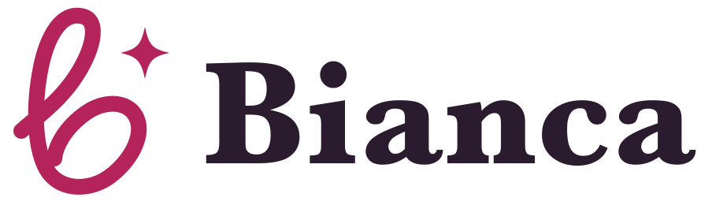

  <picture>
    <source media="(prefers-color-scheme: dark)" srcset="assets/logo-dark.svg" />
    
  </picture>

<h1 align="center">Oi! · Ciao! · Hallo! · Hi! I'm Bianca 🧡</h1>
<h3 align="center">I turn tricky problems into friendly interfaces.</h3>

  Frontend developer at ComeOn in Graz, Austria. Half Brazilian, half Italian, powered by coffee, good books and way too much Zelda.

  <a href="https://biancaespindola.netlify.app"><b>🌐 Portfolio</b></a> ·
  <a href="https://biancaespindola.netlify.app/en/case-studies"><b>📚 Case studies</b></a> ·
  <a href="https://biancaespindola.netlify.app/en/cv"><b>📄 CV</b></a> ·
  <a href="https://www.linkedin.com/in/biancadeespindola/"><b>💼 LinkedIn</b></a>

---

### ✨ Highlights

- 🏆 **Make It Happen**, ComeOn Summer Awards 2026
- 💻 **7 years** building for the web, from IoT dashboards to sportsbooks
- 🌍 **Multilingual** products shipped in EN, PT-BR and DE-AT
- 🤝 **People person**: I do my best work in collaboration, building trust and helping teams communicate clearly.

### 🗺️ My map

**Florianópolis, Brazil** → **Bari, Italy** → **Graz, Austria**
UFSC · LARM · EJEC · Khomp → Khomp, remote → ComeOn

### 📚 Case studies

- 🎄 [**How I built my site**](https://biancaespindola.netlify.app/en/case-studies/this-site): four languages with Next.js 16, design tokens and a public decision log
- ⭐ [**Sportsbook features at ComeOn**](https://biancaespindola.netlify.app/en/case-studies/sportsbook): Boosted Odds and Bet Builder in React and Next.js, in three languages
- 🛡️ [**Securing a cardiac wearable**](https://biancaespindola.netlify.app/en/case-studies/iomt-security): AES-256, SPECK and CLEFIA for ECG data on IoMT devices, published at SBSEG 2022

### 🛠️ What I work with

  

Zustand · Redux · TanStack Query · Storybook · accessibility (WCAG) · testing · code review

### 🎮 Off the clock

- 📖 Always lost in a good book: _The Lord of the Rings_, _Anne of Green Gables_, Carl Sagan
- 🗡️ Gamer with more enthusiasm than technique: _Zelda_ and _Stardew Valley_
- 🏛️ Museum wanderer and keeper of oddly specific Brazilian royal family trivia
- 🎄 Christmas market hunter and festive mug collector
- 🗣️ Portuguese (native) · English (bilingual) · Italian (A2) · German (A1)

  
  

<i>Let's grab a coffee ☕ Open to good conversations, in four languages if you like.</i>

